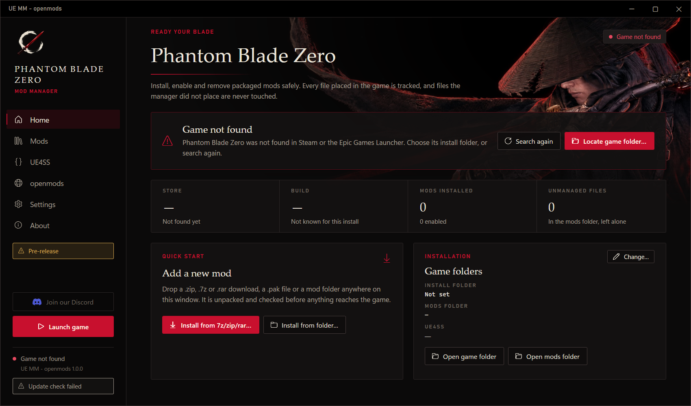

# UE MM

A mod manager for Unreal Engine games. The first supported game is **Phantom Blade Zero**.

> **Pre-release.** UE MM is at the beginning of its development. It most likely works; if something does not, an
> update with a fix follows quickly. Expect frequent changes.

## What it does

- Installs mods from a `.zip`, `.7z` or `.rar` download, a `.pak` file or a mod folder: drop it on the window. Every
  download is unpacked and checked first, and nothing inside it is ever run.
- Handles pak mods (`.pak`, `.utoc` + `.ucas`), Blueprint mods (`LogicMods`) and UE4SS Lua and DLL mods.
- Enables, disables, updates and uninstalls mods. It keeps its own copy of every mod and records a checksum for every
  file it places. Files it did not place are never overwritten or removed.
- Installs and updates UE4SS for the game, and shows the UE4SS log with its errors and warnings.
- The **openmods** page lists the game's mods from openmods: install or update one with a click.
- Changes nothing while the game runs, and keeps the settings you changed in a mod's `config.lua` across updates.
- **Reset modding** takes the game back to its original files in one step, so you can start clean.

## Screenshots



## How to install

1. Install the [.NET 8 Desktop Runtime (x64)](https://dotnet.microsoft.com/download/dotnet/8.0) if you do not have it.
2. Download `uemm-openmods_phantom-blade-zero_<version>.zip` from the latest
   [release](https://github.com/KintaroModding/uemodmanager/releases/latest).
   (`uemm_phantom-blade-zero_<version>.zip` is the same app without the openmods page.)
3. Unzip it into a folder you can write to, for example `Documents\UE MM`, not `C:\Program Files`.
4. Start `UEModManager.exe`. It finds the game through Steam or the Epic Games Launcher; otherwise choose the game
   folder in Settings.

The app is portable: it keeps everything in a `Data` folder next to the exe.

**Update:** the app checks for a new version at every start and can update itself.

**Remove:** use **Settings → Reset modding…** first, so the game is back to its original files, then delete the app's
folder.

## How to use

- **Home:** drop a download on the window, or use **Install from 7z/zip/rar…**. A review shows what goes where
  before anything reaches the game.
- **Mods:** turn mods on and off, update or uninstall them, and edit or reset a mod's settings.
- **UE4SS:** install or update UE4SS, open its folder, and read its log.
- **openmods:** browse the game's mods on openmods and install one with a click.
- **Settings:** the game folder, and the manager's data, logs and backups. **Reset modding…** removes every mod and
  UE4SS from the game; you choose whether the mods also leave the manager. **Report a problem…** makes a report for
  the help channel on Discord.

## Compatibility

- Phantom Blade Zero on Steam, on the Epic Games Store, or in a folder chosen by hand.
- Windows 10 or 11, 64-bit.

## Known issues

- Pre-release: the game's folder layout is assumed from the usual Unreal Engine layout and is being checked.
- Save backups come in a later update, once the game's save folder is known for sure.
- No load order yet: neither pak priority nor UE4SS's `mods.txt` order.

## How to build

On Windows, with the [.NET 10 SDK](https://dotnet.microsoft.com/download/dotnet/10.0) (version 10.0.100 or a later
feature band, pinned in `global.json`), from the repository root in PowerShell:

```powershell
./publish.ps1
```

It runs the tests and builds both release files into `dist/release/`:

- `uemm-openmods_phantom-blade-zero_<version>.zip` (the app with the optional catalog, the openmods page)
- `uemm_phantom-blade-zero_<version>.zip` (the same app built with `-p:Catalog=false`)

Each zip holds one `UEModManager.exe`, a single file that needs the .NET 8 Desktop Runtime. To build only the app
with the catalog:

```powershell
dotnet publish src/UEManager.UI/UEManager.UI.csproj -c Release -o dist/app
```

## Credits

- KintaroModding: creator and maintainer. Every contributor is named in `CONTRIBUTORS.md` and on the app's About page.
- [CommunityToolkit.Mvvm](https://github.com/CommunityToolkit/dotnet) and
  [SharpCompress](https://github.com/adamhathcock/sharpcompress), both MIT.
- [UE4SS](https://github.com/UE4SS-RE/RE-UE4SS), which the app installs for the game.

License: GNU General Public License, version 3, with additional terms in `NOTICE.md`.
